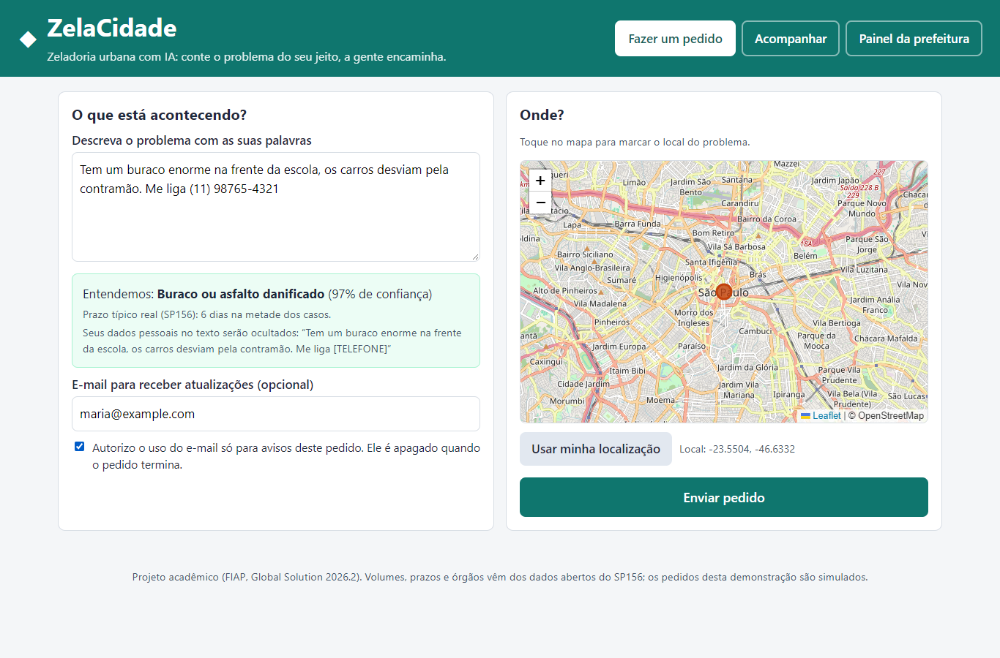
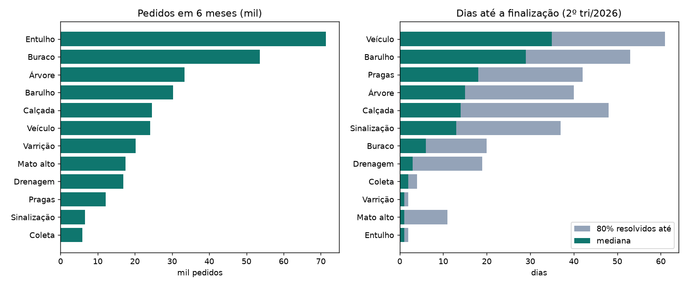
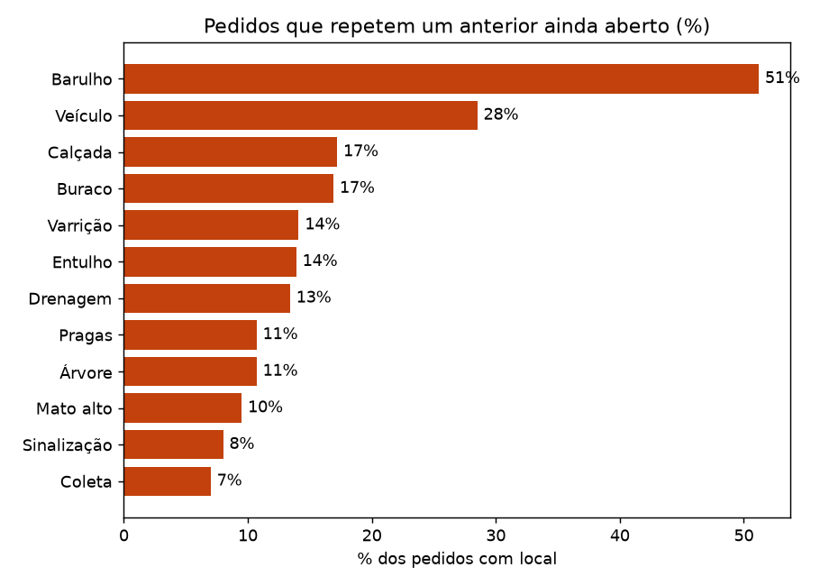
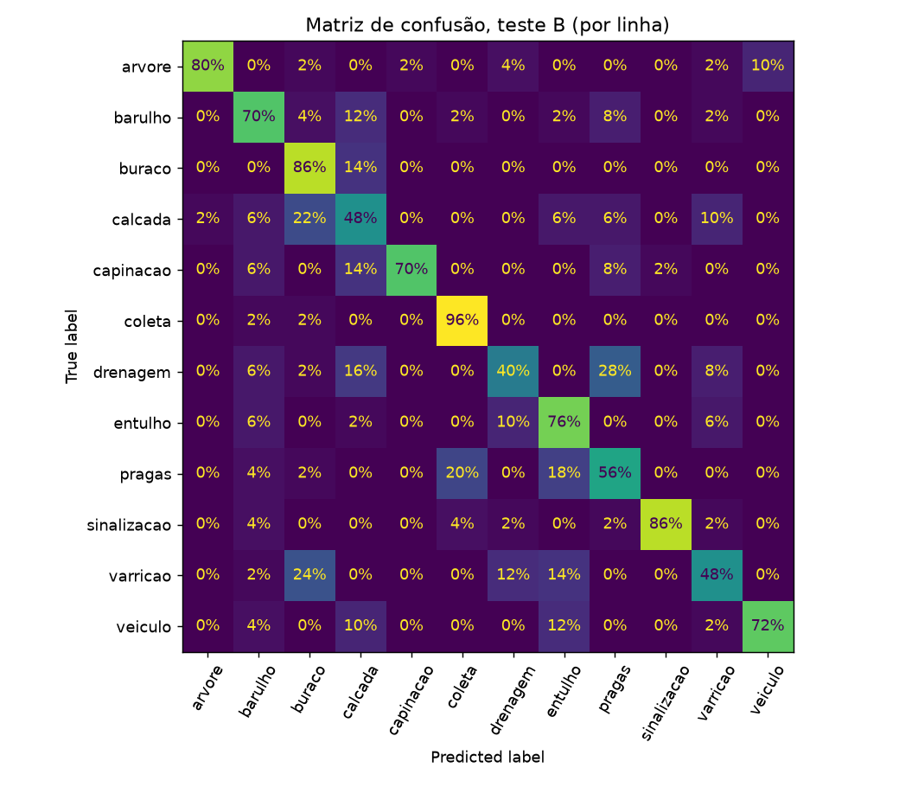
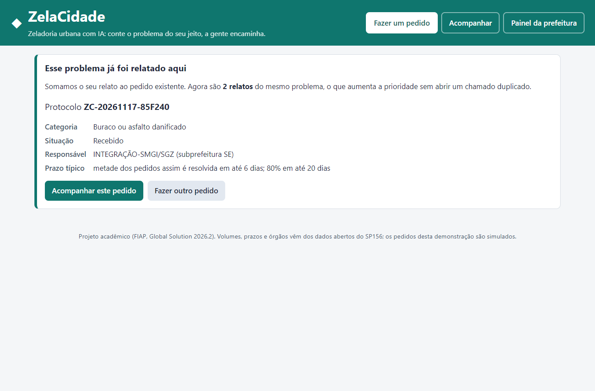
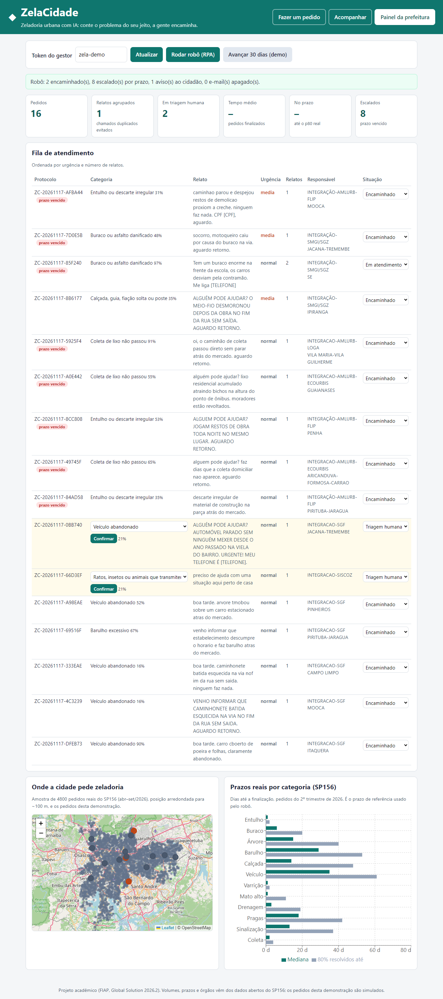

<div class="capa" markdown="1">


<p class="sobre">Global Solution 2026.2 · CitizenTech: Tecnologia centrada no cidadão</p>

# ZelaCidade

<p class="subtitulo">Zeladoria urbana com IA: o cidadão descreve o problema com as próprias palavras, e o sistema entende, agrupa, encaminha e acompanha.</p>

**Grupo Zion**

| Integrante | RM |
|---|---|
| Cesar Martinho de Azeredo | RM568140 |
| Carlos Alberto Florindo Costato | RM567005 |
| Phellype Matheus Giacoia Flaibam Massarente | RM566826 |

**Turma:** {{TURMA}}

**Curso:** Graduação em Inteligência Artificial (2º ano), FIAP

**Repositório GitHub (privado, compartilhado com fiap-tutoria):** https://github.com/Phemassa/GLOBAL_SOLUTION_2026.2

**Vídeo demonstrativo (YouTube, não listado):** https://youtu.be/ZWwgtndyjF8

</div>

## 1. Introdução

### 1.1 O problema

Buraco no asfalto, entulho na calçada, bueiro entupido, árvore com risco de queda, mato alto, barulho de madrugada: a zeladoria urbana é o serviço público mais presente no dia a dia de quem mora numa cidade grande. Em São Paulo, esses pedidos entram pelo canal SP156. Os dados abertos da Prefeitura mostram **316.522 pedidos** nas 12 categorias de zeladoria tratadas aqui, só entre abril e setembro de 2026.

A análise desses dados reais (seção 3.1) mostra três dificuldades concretas:

1. **O cidadão precisa saber como a Prefeitura se organiza.** As 12 categorias somam 38 serviços oficiais com nomes técnicos, como "Guias, sarjetas e sarjetões - solicitar manutenção". O órgão responsável também muda conforme a região: na categoria de pragas, o órgão mais frequente atende só 11% dos pedidos.
2. **Há muito retrabalho.** **18,4%** dos pedidos (58.161) repetem outro da mesma categoria, no mesmo ponto, que ainda estava aberto. Em barulho, a repetição chega a 51%.
3. **Os prazos são desiguais e pouco visíveis.** A mediana até a finalização vai de 1 dia (entulho, varrição) a 35 dias (veículo abandonado). Nesta última categoria, 77% dos pedidos do 2º trimestre ainda estavam abertos ao final do período.

### 1.2 Quem se beneficia

- **Moradores**, em especial os menos familiarizados com serviços digitais: podem escrever do próprio jeito, sem escolher numa lista de categorias técnicas, e recebem protocolo, prazo típico e avisos.
- **Equipes de atendimento da Prefeitura:** menos triagem manual e menos chamados duplicados. Os casos difíceis chegam sinalizados para revisão humana.
- **Gestores públicos:** indicadores de prazo, atraso e volume por categoria e região, para decidir onde reforçar equipes.

### 1.3 Objetivo

Construir uma prova de conceito que receba o relato livre do cidadão e:

1. proteja seus dados pessoais;
2. identifique a categoria, pedindo ajuda humana quando não tiver certeza;
3. agrupe relatos repetidos;
4. encaminhe ao órgão que de fato atende aquele problema naquela região;
5. acompanhe o prazo e avise o cidadão.

### 1.4 Objetivos de Desenvolvimento Sustentável

| ODS | Meta relacionada | Contribuição do ZelaCidade |
|---|---|---|
| **11 – Cidades e comunidades sustentáveis** | 11.3 (planejamento participativo) e 11.6 (gestão de resíduos) | Facilita o relato de problemas urbanos, incluindo entulho e descarte irregular (as maiores categorias), e organiza a demanda por região |
| **16 – Instituições eficazes, responsáveis e transparentes** | 16.6 (instituições eficazes e transparentes) e 16.7 (decisão responsiva e participativa) | Prazos reais visíveis ao cidadão, escalonamento automático de atrasos e indicadores públicos de desempenho |

## 2. Desenvolvimento

### 2.1 Como funciona

| Etapa | O que acontece | Técnica | Disciplina |
|---|---|---|---|
| 1. Relato | O cidadão escreve em texto livre e marca o local no mapa | Interface React com Leaflet/OpenStreetMap | Front-end (React) |
| 2. Privacidade | Telefone, CPF e e-mail são trocados por marcadores **antes** de gravar | Expressões regulares | Governança de dados (LGPD) |
| 3. Categoria | O texto vira categoria com grau de confiança; abaixo de 30%, vai para triagem humana | TF-IDF (palavras e caracteres) + regressão logística | NLP |
| 4. Urgência | Sinais de risco ("fio", "choque", "criança", "sem tampa") sobem a prioridade | Regras explícitas e auditáveis | Python |
| 5. Agrupamento | Mesma categoria, até 30 m, ainda aberto: soma um apoio, não abre outro chamado | Distância de Haversine | Python / dados |
| 6. Roteamento | Subprefeitura pelo ponto marcado; órgão pela tabela real do SP156 | Vizinho mais próximo numa grade de 67 mil células reais | Dados |
| 7. Prazo | O cidadão vê a mediana e o p80 reais da categoria | Estatística dos dados reais | Dados |
| 8. Automação | O robô envia o ofício, escala o que passou do prazo, avisa o cidadão e apaga o e-mail no fim | Robô agendado (RPA) + e-mail | Automação / RPA |
| 9. Integração | Tudo exposto por API REST documentada | FastAPI + SQLite | APIs REST |


<p class="legenda">Figura 1 – Tela do cidadão. Enquanto ele escreve, o sistema mostra a categoria entendida (97% de confiança), o prazo típico real e como o telefone será ocultado.</p>

### 2.2 Dados: origem, tratamento e limitações

**Fonte real.** "Dados do SP156 - Solicitações", Prefeitura de São Paulo, Portal de Dados Abertos, licença **Creative Commons CC0**. Usamos o 2º e o 3º trimestres de 2026, com 947.918 pedidos no total, 316.522 deles nas 12 categorias. O acesso foi em 17/11/2026.

**Tratamento** (`src/zela/dados.py`):

- **Formatos inconsistentes na origem.** O 2º trimestre vem em Windows-1252, com ponto e vírgula e data dia/mês; o 3º, em UTF-8, com vírgula e data mês/dia. Como "01/04" é válido nos dois formatos, o formato de data é escolhido pelo que coloca as aberturas dentro do trimestre, e a leitura **falha** se menos de 99,9% caírem lá. Um erro silencioso de data invalidaria todos os prazos.
- **Categorias pelo serviço oficial, não pelo assunto.** Essa decisão veio da própria análise. O assunto "Sinalização e Circulação" é 70% isenção de rodízio para pessoas com deficiência, que não é zeladoria, e "Fiação e Postes" é quase todo manutenção de calçada. Filtrar pelo assunto teria contaminado volumes e prazos.
- **Prazo:** dias entre abertura e finalização, só de pedidos **finalizados do 2º trimestre**. Os pedidos longos do 3º ainda estavam abertos e puxariam a mediana para baixo (viés de censura).
- **Qualidade:** a coluna de subprefeitura contém valores que não são subprefeituras, como "Prefeitura Regional nao encontrada", e eles foram excluídos.
- **Privacidade:** coordenadas arredondadas para ~100 m; logradouro, número e CEP não são exportados.

**Dados sintéticos (identificados como tal).** A Prefeitura **não publica o texto escrito pelo cidadão**, só a categoria. Os textos para treinar e testar o classificador foram escritos pelo grupo:

- **1.800 de treino:** frases do grupo A e combinações de vocabulário, parte dele tirada dos nomes oficiais dos serviços.
- **600 de teste:** frases do grupo B, que nunca aparecem no treino.
- **36 escritos à mão** em linguagem coloquial, antes de qualquer resultado.

Todos têm ruído de escrita informal e, em 15% dos casos, dados pessoais **inventados**, para testar a anonimização.

**Fora do escopo:** iluminação pública não está nos dados abertos do SP156; em São Paulo ela é atendida por outro canal.

### 2.3 Processamento de linguagem natural

**Pré-processamento:** anonimização, depois minúsculas, remoção de acentos e de pontuação.

**Representação e modelo:** TF-IDF com duas visões do texto, combinado a uma regressão logística.

- **Palavras e pares de palavras** capturam o assunto.
- **Pedaços de 3 a 5 caracteres** toleram erros de digitação.
- **A regressão logística** devolve uma probabilidade para cada categoria.

Comparamos três modelos numa **validação cruzada agrupada pela frase de origem**: cada dobra testa frases que não estavam no treino daquela dobra.

| Modelo | Acurácia | F1 macro |
|---|---|---|
| Naive Bayes (palavras) | 0,636 | 0,640 |
| Regressão logística (palavras) | 0,709 | 0,714 |
| **Regressão logística (palavras + caracteres)** | **0,839** | **0,839** |

**Triagem humana.** O limiar de confiança foi definido **antes de olhar o teste**: o menor valor que mantém pelo menos 90% de acerto nos pedidos automáticos na validação agrupada. O resultado foi **0,30**. Abaixo dele, o pedido não é encaminhado sozinho: um atendente confirma ou corrige a categoria no painel, e a correção fica registrada.

**Por que não um modelo de linguagem grande?** TF-IDF com regressão logística treina com poucos dados, roda em qualquer servidor público sem custo por chamada, devolve probabilidades úteis para a triagem e permite explicar quais palavras pesaram.

### 2.4 Automação (RPA) e API REST

O robô (`src/zela/rpa.py`) roda em ciclos, por agendamento ou pelo botão no painel. Em cada ciclo ele:

1. **Encaminha** cada pedido novo: gera o ofício por e-mail ao órgão, com categoria, subprefeitura, local, urgência, número de relatos e prazo de referência.
2. **Escala** o que passou do p80 real da categoria: avisa a coordenação da subprefeitura e eleva a prioridade.
3. **Avisa o cidadão** de cada mudança de status, e só uma vez.
4. **Apaga o e-mail** do cidadão quando o pedido termina (retenção mínima).

Sem servidor SMTP configurado, os e-mails são gravados como arquivos `.eml`, o que permite inspecioná-los nos testes.

| Rota | Quem usa | Função |
|---|---|---|
| `POST /api/classificar` | Cidadão (prévia) | Categoria, confiança, prazo e texto anonimizado; nada é gravado |
| `POST /api/solicitacoes` | Cidadão | Cria o pedido ou soma um apoio a um igual próximo |
| `GET /api/solicitacoes/{protocolo}` | Cidadão | Situação e linha do tempo |
| `GET /api/solicitacoes` | Gestor (token) | Fila ordenada por urgência e número de relatos |
| `PATCH /api/solicitacoes/{protocolo}` | Gestor (token) | Muda status, confirma ou corrige a categoria |
| `POST /api/rpa/executar` | Gestor (token) | Roda um ciclo do robô |
| `GET /api/indicadores` | Público | Indicadores de impacto |

### 2.5 Governança e proteção de dados

- **Minimização:** o texto é anonimizado antes de gravar; o original nunca é armazenado.
- **Consentimento:** o e-mail só é guardado com autorização explícita, em tabela separada, e é exibido mascarado (`m***@exemplo.com`).
- **Retenção:** o robô apaga o e-mail quando o pedido é finalizado ou cancelado.
- **Transparência:** confiança, alternativas e motivo da urgência ficam visíveis; a urgência usa regras que qualquer pessoa pode conferir.
- **Supervisão humana:** pedidos de baixa confiança não são encaminhados sem um atendente; toda correção é registrada.
- **Controle de acesso:** as rotas do gestor exigem token. Na POC é um token fixo; em produção seria autenticação individual com registro de quem fez cada mudança.

### 2.6 Códigos principais

**Anonimização** (`src/zela/nlp.py`). Telefone exige separador para não apagar o CEP, que indica o local do problema, não a pessoa:

```python
PADROES_PESSOAIS = [
    (re.compile(r"\b[\w.+-]+@[\w-]+\.[\w.]+\b"), "[EMAIL]"),
    (re.compile(r"\b\d{3}\.?\d{3}\.?\d{3}-?\d{2}\b"), "[CPF]"),
    (re.compile(r"(?:\(\d{2}\)\s?|\b\d{2}\s)?\b9?\d{4}[-\s]\d{4}\b"), "[TELEFONE]"),
]

def anonimizar(texto: str) -> str:
    for padrao, marcador in PADROES_PESSOAIS:
        texto = padrao.sub(marcador, texto)
    return texto
```

**Modelo e triagem** (`src/zela/nlp.py`):

```python
def criar_modelo():
    vetorizador = FeatureUnion([
        ("palavras", TfidfVectorizer(preprocessor=normalizar, ngram_range=(1, 2), min_df=2, sublinear_tf=True)),
        ("caracteres", TfidfVectorizer(preprocessor=normalizar, analyzer="char_wb", ngram_range=(3, 5),
                                       min_df=2, sublinear_tf=True)),
    ])
    return make_pipeline(vetorizador, LogisticRegression(C=5.0, max_iter=2000))

def classificar(texto):
    probabilidades = modelo().predict_proba([anonimizar(texto)])[0]
    ...
    return {"categoria": melhor, "confianca": confianca,
            "triagem_humana": confianca < LIMIAR_CONFIANCA, "alternativas": ...}
```

**Agrupamento de relatos** (`src/zela/db.py`):

```python
for c in candidatos:   # mesma categoria, status aberto
    if referencia.distancia_m(lat, lon, c["lat"], c["lon"]) <= RAIO_AGRUPAMENTO_M:   # 30 m
        con.execute("UPDATE solicitacoes SET apoios = apoios + 1 ... WHERE protocolo = ?", ...)
        _registrar(con, c["protocolo"], "Novo apoio", "Outro cidadão relatou o mesmo problema no local")
        return {**detalhar(c["protocolo"], con), "agrupado": True}
```

**Escalonamento pelo prazo real** (`src/zela/rpa.py`):

```python
limite = datetime.fromisoformat(p["encaminhado_em"]) + timedelta(days=p["prazo_p80"])
if agora > limite:
    enviar(caixa_da_coordenacao, f"[ZelaCidade] Prazo vencido {p['protocolo']}", ...)
    con.execute("UPDATE solicitacoes SET escalado_em = ?, pontos_urgencia = pontos_urgencia + 2 ...")
```

## 3. Resultados obtidos

### 3.1 O problema nos dados reais


<p class="legenda">Figura 2 – Pedidos reais em 6 meses e dias até a finalização por categoria (SP156, 2026). A desigualdade de prazo justifica usar um prazo de referência por categoria.</p>


<p class="legenda">Figura 3 – Pedidos que repetem um anterior da mesma categoria, no mesmo ponto (~11 m), ainda aberto: 18,4% no total. É o retrabalho que o agrupamento automático evita.</p>

### 3.2 Desempenho do classificador

O modelo final foi treinado com todo o conjunto A e avaliado **uma única vez** nos conjuntos que não participaram do treino:

| Conjunto | n | Acurácia geral | F1 macro | Vão para triagem humana | Acerto nos automáticos | Erros encaminhados sem revisão |
|---|---|---|---|---|---|---|
| Teste B (frases nunca vistas) | 600 | 0,690 | 0,691 | 28,8% | 78,5% | 15,3% |
| Escritas à mão | 36 | 0,778 | 0,786 | 11,1% | 81,2% | 16,7% |

**Leitura crítica.** O limiar foi escolhido para 90% de acerto nos pedidos automáticos, mas esse número **não se manteve** fora do treino: nas frases novas, foram 78,5%. A validação dentro do treino foi otimista, provavelmente porque as frases do mesmo conjunto compartilham vocabulário e estrutura.

Os erros mais comuns têm duas causas:

- **Vocabulário ausente do treino:** "caliça", "carreto", "matagal".
- **Relatos que mencionam duas categorias:** "carro de som" fala de carro e de barulho; "galhos encostando na fiação" fala de árvore e de fiação.

O modelo, portanto, é útil como **triagem assistida**, não como decisão final.


<p class="legenda">Figura 4 – Matriz de confusão no teste B (proporção por categoria real).</p>

### 3.3 Testes do protótipo

**Testes automatizados do backend** (`tests/test_backend.py`, pytest): **10 testes, todos passando.** Cobrem anonimização (incluindo o caso do CEP); classificação; urgência; roteamento com subprefeituras reais (Praça da Sé → SE; Largo da Batata → Pinheiros; um ponto no Rio de Janeiro → fora da cidade); o fluxo completo cidadão → robô → gestor, com agrupamento a 10 m e não agrupamento a ~110 m; ofício e aviso enviados uma única vez; escalonamento por prazo; exclusão do e-mail ao final; triagem humana e correção; e segurança e validação (token, campos inválidos, e-mail sem consentimento não gravado).

**Teste ponta a ponta da interface** (`src/demo/e2e_interface.py`): roda num navegador real (Microsoft Edge, Playwright) e confere cada passo na tela antes de salvar o print. **Todos os passos passaram**:

| Passo | Verificação |
|---|---|
| Prévia | Categoria "Buraco" e telefone mascarado |
| Pedido | Criado e roteado à subprefeitura da Sé |
| Relato repetido | Agrupado no mesmo protocolo |
| Texto vago | Enviado para triagem humana |
| Robô | Encaminhamentos feitos |
| Atendente | Confirmou um pedido correto e corrigiu um errado |
| Prazo vencido | Escalado e sinalizado na fila |
| Linha do tempo | Sem o telefone do cidadão |

O robô gerou 22 e-mails (ofícios, escalonamentos e avisos).


<p class="legenda">Figura 5 – Um segundo cidadão relata o mesmo buraco: o sistema soma o relato ao protocolo existente em vez de abrir outro.</p>


<p class="legenda">Figura 6 – Painel da prefeitura após o robô e o avanço de 30 dias (demonstração): indicadores, fila priorizada com prazos vencidos sinalizados, pedidos em triagem humana, mapa com a amostra real do SP156 e prazos reais por categoria.</p>

**Erros reais à vista na demonstração.** O painel da Figura 6 mostra erros do modelo, que não foram escondidos. Por exemplo, "árvore tombou sobre um carro" foi classificada como *Veículo abandonado*, com 52% de confiança, e encaminhada automaticamente.

### 3.4 Como medir o impacto

Os pedidos usados na demonstração são simulados; portanto, **os números abaixo são metas e linhas de base, não resultados medidos em operação**. A tabela também separa o que o painel (`/api/indicadores`) já calcula do que dependeria de uso real.

| Indicador | Linha de base real (SP156) | Como o ZelaCidade mede | Meta de um piloto |
|---|---|---|---|
| Chamados duplicados | 18,4% repetem um pedido aberto | Relatos agrupados ÷ relatos recebidos | Agrupar ≥ 80% das repetições |
| Pedidos no prazo | Prazo p80 real por categoria | % finalizados até o p80 da categoria | Subir 10 pontos percentuais |
| Atrasos sem resposta | Não medido na base | Pedidos escalados por prazo vencido | Todo atraso escalado em até 1 dia |
| Triagem manual | Hoje 100% dependem de o cidadão escolher a categoria | % em triagem humana e % corrigidos pelo atendente | Reduzir o retrabalho de triagem, com erro abaixo de 10% |
| Equidade territorial | Volume por subprefeitura | Pedidos e prazos por subprefeitura | Reduzir a diferença de prazo entre regiões |

## 4. Conclusões

O ZelaCidade mostra, com dados reais da cidade de São Paulo, que é possível tirar do cidadão o peso de entender a estrutura da Prefeitura: ele escreve do próprio jeito, e o sistema anonimiza, entende, agrupa repetições, encaminha ao órgão certo para a região e acompanha o prazo. Os dados reais justificam cada parte: 316 mil pedidos em 6 meses, 18,4% de repetição e prazos de 1 a 35 dias.

O protótipo integra as disciplinas do ano:

- **NLP:** classificação do relato.
- **Automação de processos e RPA:** robô de encaminhamento e acompanhamento.
- **API REST:** FastAPI.
- **Interface React:** cidadão e prefeitura.
- **Governança de dados e LGPD:** anonimização, consentimento e retenção.

Tudo foi testado de forma automatizada, inclusive no navegador.

**Limitações:**

- **Textos sintéticos.** Os textos dos cidadãos foram escritos pelo grupo. O desempenho do classificador (69% de acerto geral em frases novas) não representa o de relatos reais, e o limiar de triagem não se manteve fora do treino.
- **Classificador simples.** Ele escolhe uma categoria por relato e não lida com vocabulário muito diferente do treino.
- **Distâncias aproximadas.** O agrupamento por 30 m e a subprefeitura pela grade de ~100 m são aproximações, que podem falhar em divisas e em locais com muitos problemas próximos.
- **Prazos subestimados.** Os pedidos ainda abertos não entram no cálculo.
- **E-mails fictícios dos órgãos.** Os endereços reais dos órgãos não são públicos, então não há integração com os sistemas da Prefeitura. Iluminação pública ficou fora do escopo.
- **Segurança de POC.** Banco em arquivo e token fixo de gestor. Não houve teste com usuários reais nem de acessibilidade com leitor de tela.

**Próximos passos:**

1. Piloto com relatos reais anonimizados, em parceria com uma subprefeitura.
2. Retreinar e recalibrar o limiar com esses dados, aproveitando as correções dos atendentes.
3. Permitir mais de uma categoria por relato.
4. Integrar com o sistema oficial em vez de e-mail.
5. Testar com moradores de diferentes idades e regiões.

**Projeto acadêmico:** não substitui o SP156 nem foi validado pela Prefeitura de São Paulo.

## Links da entrega

- **Repositório GitHub (privado, compartilhado com fiap-tutoria):** https://github.com/Phemassa/GLOBAL_SOLUTION_2026.2
- **Vídeo demonstrativo (YouTube, não listado):** https://youtu.be/ZWwgtndyjF8
- **Dados reais:** https://dados.prefeitura.sp.gov.br/dataset/dados-do-sp156
